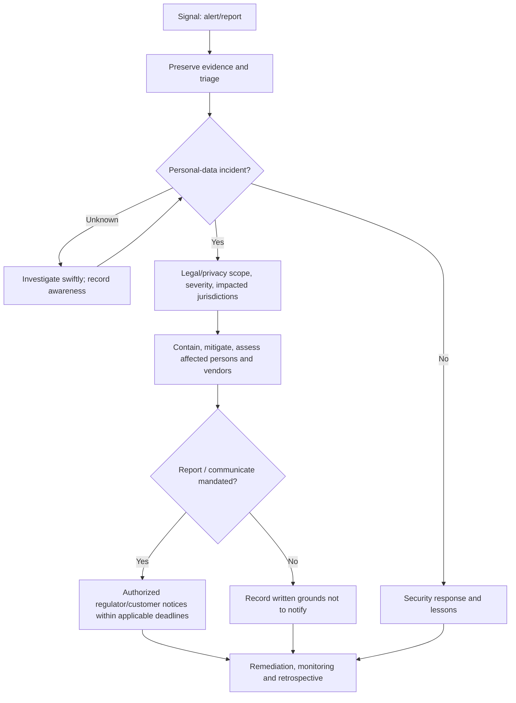

# Security controls with legal consequences + incident response

**Legal question is not the same as technical scan.** A successful OWASP test cannot demonstrate compliance with data-protection law. Read [existing Engineering-OS security pattern](../../patterns/security/README.md) for ASVS, MASVS, threat modeling, SAST, SCA, secret scanning and evidence. Consult current [Israeli PPA security implementation guide](https://www.gov.il/he/pages/data_security_guide?chapterIndex=11), [2026 FAQ](https://www.gov.il/he/pages/data_security_fqa?chapterIndex=1), [PPA breach portal](https://www.gov.il/he/service/report-of-data-breach), [EDPB breach guidance](https://www.edpb.europa.eu/sme/assess-the-risks/data-breaches_en) and [NIST SP 800-61r3](https://www.nist.gov/news-events/news/2025/04/nist-revises-sp-800-61-incident-response-recommendations-and-considerations).

## Translate legal duties into engineering tickets

| Risk/control | Implement & verify | Legal/compliance evidence |
|---|---|---|
| Classification & accountability | Inventory actual data assets, sensitivity, database size, access roles, applicable Israeli regulatory security level | Dated classification and approved database/system description |
| Data minimization | Drop unnecessary fields, redact telemetry, short-lived debug files, prevent secrets/PII in LLM prompts where not needed | Data map + network/DB inspection |
| Identity and access | MFA for privileged accounts where warranted, least privilege, RLS/tenant isolation, authorized access review, revoke offboarded users | Matrix of role tests and review |
| Vendor/cloud security | Authorize subprocessors, least-privilege service credentials, contractual controls, sandbox production separation | DPA, processor inventory, incident contacts, actual access pathways |
| Encryption/key security | Modern transport encryption, suitable encryption at rest, key rotation and protection, secret scanning | Config/test evidence; avoid publishing key details |
| Logging, auditing, alerts | Trace relevant privileged access and incidents without sensitive payloads; preserve logs per **applicable** regulation/needs | Retention/quality of audit trail, tamper-resistance, consent and data rights consideration |
| Vulnerability management | SAST/SCA/DAST, patch SLAs by risk, pentest of authorized targets, CI evidence and remediation | Exact build, tool version, severity, accepted residual risk |
| Backup, deletion & restoration | Test restoration, retention expiry, backup deletion lifecycle, legal hold conditions, tenant isolation | Restore test results and documented retention exceptions |
| Incident management | Named commander, security engineer, legal/privacy lead, supplier contacts; containment, forensics, notification criteria | Immutable incident timeline, decision log and approved messages |
| Training & oversight | Appropriate staff/admin training and periodic assessment by applicable security level | Training record, owner, date |
| Honest notices | Do not claim 100% secure or certifications never obtained | Product/legal copy reviewed against evidence |

**Israeli regulations use classifications/thresholds** — don't copy one prescribed requirement from "high" to all databases or assume a small operator is automatically exempt.

## Incident-response state machine



### Triage record — minimum facts

```yaml
incident_id: "<internal ID>"
first_signal_at: "<timestamp and source>"
awareness_assessment_at: "<document when controller had reasonable certainty>"
systems_and_data: "<categories/counts estimated and confidence>"
jurisdictions: ["<country/state>"]
controller_or_processor: "<role>"
severity_and_risk_to_people: "<analysis>"
containment: ["<action and time>"]
affected_processors: ["<contact/notice obligations>"]
israel_serious_event: "YES|NO|UNDETERMINED"
gdpr_72h_rule_applicable: "YES|NO|UNDETERMINED"
notification_decision: "<legal rationale + approver + time>"
notices_sent: ["<authority, recipient, date, delivery evidence>"]
preservation_and_remediation: ["<evidence / plan>"]
status: "OPEN|MITIGATED|CLOSED"
```

**Deadlines must be researched per incident.** Under relevant GDPR controller obligations, supervisory authority notice is generally within **72 hours of awareness** unless unlikely to result in risk; some incidents require communication to people without undue delay; processors notify controllers without undue delay. Under Israeli regulations, a **serious security incident** in a qualifying database must be reported promptly/immediately according to Israeli PPA instructions — **not an assumed 72-hour Israeli rule**. Provider contracts may impose shorter deadlines.

## Example incident language — INTERNAL DRAFT only

- User-facing preliminary fact: `אנו בודקים אירוע אבטחת מידע שעשוי להשפיע על [תיאור מאומת של שירות/מידע]. נעדכן מידע מאומת וצעדים מומלצים בהמשך.`
- Avoid: `Your information is safe` if unknown, `no breach occurred` without investigation, `everyone's data was stolen` without proof.
- Notify only through authorized incident communications; no automatic email blast from monitoring alert.

## Test scenarios

1. Wrong-tenant ID cannot retrieve booking records; assert 403/404 and no side channels.
2. Misconfigured object/media sharing revoked, future links expire; confirm cloud storage ACLs.
3. Auth token or PII accidentally enters application logs; fail policy tests and scrub.
4. Breach event triggered in isolated staging: owner paged, legal assessment started, timestamped evidence, approved escalation.
5. Restore from backup and delete old data according to approved schedule (include third-party copies).
6. Secret leak response: revoke/rotate, check access records, block repeat, preserve incident report.

**Statuses:** PASS/FAIL/PARTIAL/BLOCKED/NOT TESTED/NOT APPLICABLE per exact revision and environment. Compliance sign-off separate from technical PASS. Do not publicly expose internal incident details, secret values or vulnerabilities through documentation.
