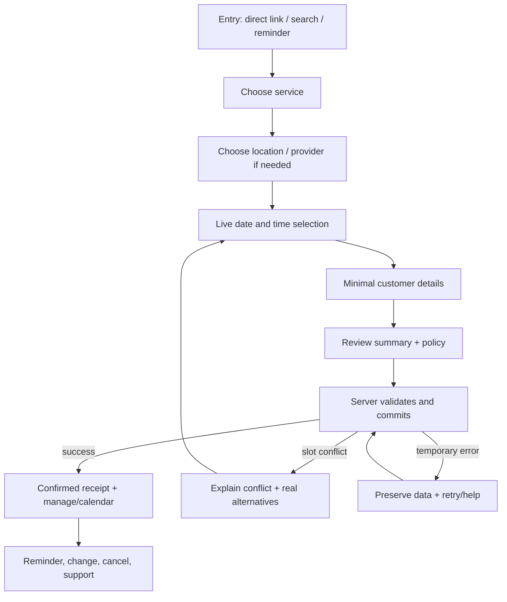

# Worked example — from generic appointment app to distinctive experience

**Illustrative only**: a service-booking product. No specific business, price, review, slot or availability is asserted; bracketed fields are **runtime data requiring server verification**. This case demonstrates how to use the library without cloning a real brand. Combine with `templates/booking-system/README.md` for architecture, then verify backend behavior separately.

## 1. Before choosing colors: audience & differentiation

**Job:** "I need to find a suitable provider, choose an actually available time, understand the price and policy, and know for sure the booking was confirmed."

**Anxieties:** Is the slot really free? What exactly will it cost? Will I be charged? Can I reschedule? Where do I go? Does the professional fit my need?

**Value hypothesis:** "Choose a service and confirmed appointment in a short, transparent journey." A conversion assertion would require measurement; this is a design goal.

### Three alternative creative directions to evaluate

| Direction | Visual identity | Writing style | Signature microinteraction | Best when |
|---|---|---|---|---|
| Calm / reassuring | Editorial hierarchy, high-legibility typography, restrained spacing, trust information adjacent to actions | Plain, specific and calm | Selected slot settles into clear review card | Appointment is sensitive, formal or high-stakes |
| Energetic / local | Distinctive real provider portraits with permission, warm colors and lively but controlled rhythm | Friendly, brief and local | Service cards transition into date picker | Audience values community, familiarity and personality |
| Premium / considered | Strong original photography, refined typography, controlled negative space, transparent detailed service specs | Confident, concise, not pretentious | Smooth container transformation at review | High-consideration service with credible premium brand |

**Reject defaults:** "Your booking journey starts here", unrealistic illustrations of smiling workers, unverified five-star reviews, universal glassmorphism, unrelated auto-playing scroll animations. The right choice depends on real brand and audience evidence.

## 2. Whole-service screen inventory with exact content

| Step / state | Example Hebrew heading | Real data / controls to show | Action and expected result |
|---|---|---|---|
| Landing | `תור שמתאים ליום שלך` | Real service types, location and verified unique selling point; primary action above distraction | `לצפייה בתורים הפנויים` → opens discovery |
| Service selection | `מה תרצו לקבוע?` | Service description, duration, verified fee/range & what's included | `בחירת [שם השירות]` → selection persists |
| Staff/location (if relevant) | `עם מי והיכן?` | Credentials if verified, real location/map, languages, remote/in-person | `המשך לבחירת זמן` |
| Calendar | `מתי נוח לכם?` | Locale, timezone, availability from backend, selected duration and resource; no dead controls | `בחירת [תאריך, שעה]` (still not confirmed) |
| Personal details | `לאן לשלוח את פרטי התור?` | Minimal required contact fields, privacy and optional preferences; inline validation | `המשך לסיכום` |
| Review | `לפני שמאשרים — אלה הפרטים` | Service, professional, venue, date/time/timezone, fee/tax/deposit and cancellation terms; editable rows | `אישור התור` triggers backend request, **not** immediate success |
| Pending | `בודקים שהשעה עדיין פנויה…` | Loading state, disable duplicate submits, persistence and retry policy | No confirmed state until backend acknowledges |
| Confirmed | `התור נקבע!` | Server-confirmed reference, time/location, notification destination, next step | `הוספה ליומן` + `שינוי או ביטול` |
| Unavailable conflict | `השעה שבחרתם כבר נתפסה` | Preserve previous service and details, offer next available **real** slots | `הצגת שעות אחרות` |
| No availability | `אין תורים פנויים ביום הזה` | Alternative days/provider/location if actually available, clear filters and notify-me with consent | `בחירת יום אחר` |
| Existing booking | `אלה התורים שלך` | Current real statuses, date/time/timezone, policy, location; history vs upcoming | `צפייה בפרטי התור` |
| Manage booking | `רוצים לשנות את התור?` | Policy/deadline/refund, reschedule and cancel operations with review | `בחירת מועד חדש` / `ביטול התור` |
| Service error/offline | `לא הצלחנו לבדוק כרגע את הזמינות` | Clarify no commitment happened, preserve input, optional support | `ניסיון נוסף` |
| Transactional email | `התור שלך אושר ל-[תאריך]` | Verified details, location, service, contact, cancellation link, help | `ניהול התור` |
| SMS/push reminder | `תזכורת: התור שלך מחר ב-[שעה]` | Real time and product name, safe previews, opt-out/channel rules | Valid deep link if supported |
| Post-appointment | `איך היה הביקור?` | Ask only after real completed status and valid consent; no coerced ratings | `שיתוף משוב` |

## 3. Text-first interaction sequence

### Functional requirements behind the experience

- Server rechecks availability atomically at confirmation, handles collision and repeated clicks idempotently.
- Booking status comes from authoritative persisted state; a success animation cannot preempt it.
- Timezones and business hours are unambiguous; dates and money are correctly localized.
- Input is preserved on error; back navigation doesn't lose work.
- Email/SMS/push content must agree with backend status and user preferences, with secure account/deep links.
- Screen-reader date picker and keyboard controls follow [ARIA patterns](https://www.w3.org/WAI/ARIA/apg/patterns/); reduced-motion mode works.
- True costs, policies, user consent and unambiguous edit/cancel options are part of the design.

## 4. Practical screenshot/flow reference search

Use [Mobbin](https://mobbin.com/) for **calendar, appointment, provider, pricing, review, cancellation and empty-state** mobile/web searches. Use [Page Flows](https://pageflows.com/) for full onboarding/booking flow when accessible; [SaaSFrame](https://www.saasframe.io/) for SaaS product and pricing UI; [Lapa Ninja](https://www.lapa.ninja/) and [SiteInspire](https://www.siteinspire.com/) for visual positioning. Use [GOV.UK check answers](https://design-system.service.gov.uk/patterns/check-answers/) and [confirmation pages](https://design-system.service.gov.uk/patterns/confirmation-pages/) for trustworthy functional patterns; use [Apple onboarding](https://developer.apple.com/design/human-interface-guidelines/onboarding) when onboarding is required.

**Research evidence table to fill in before development:**

| Reference URL | Actual inspected product/screen and date | What to borrow as a principle | What not to copy | Applicability |
|---|---|---|---|---|
| (add after inspection) | (do not invent) | e.g. service-card hierarchy | brand assets/text/layout clone | first booking |
| (add after inspection) | (do not invent) | e.g. status continuity | animation duration blindly | conflicts |
| (add after inspection) | (do not invent) | e.g. confirmation details | another product's policy | success |

## 5. Acceptance stories and test data

- **Busy first-time user:** can identify needed service, fee, real available slot and cancellation policy without asking support.
- **Screen-reader customer:** can independently choose date/time, review, submit and hear the real response.
- **Returning user:** opens reminder and can manage the correct appointment without repeating details.
- **Collision scenario:** another session claims selected slot before confirmation; user gets truthful conflict and keeps previously entered details.
- **Network-failure scenario:** no false success; idempotent retry; message accurately explains what was and wasn't saved.
- **RTL mobile:** long Hebrew copy and dynamic data remain legible; calendar direction and mixed Hebrew/English times are sensible.
- **Consent/privacy:** opt-in and messaging preferences respected; lock-screen preview doesn't expose unnecessarily sensitive details.

**Deliverables for a real project:** chosen creative direction with rationale, annotated wireframes and real-language copy for *all* steps, state machine and data contract, accessibility plan, implementation captures and a verified experience scorecard. No fabricated user-study results.
